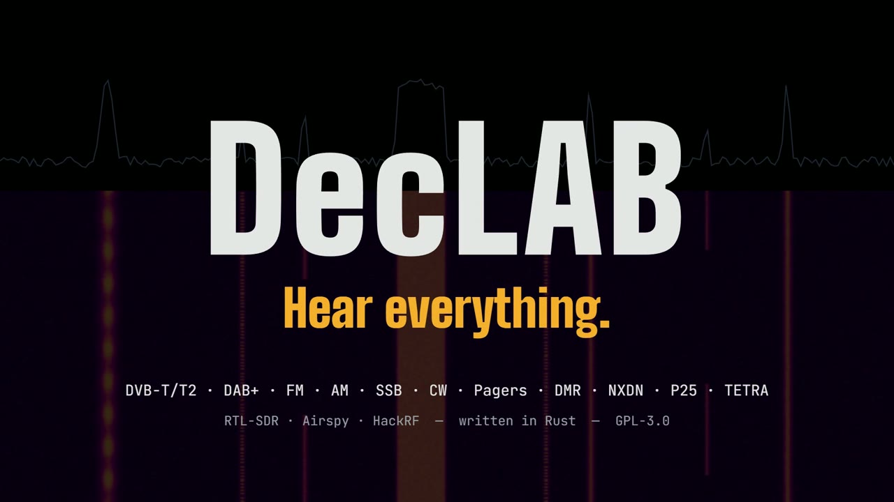
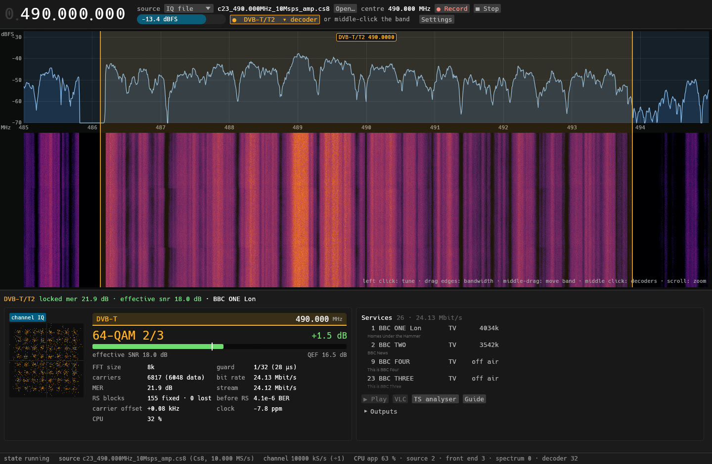
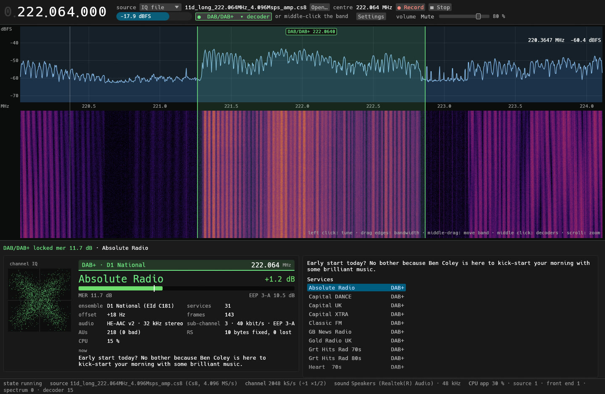
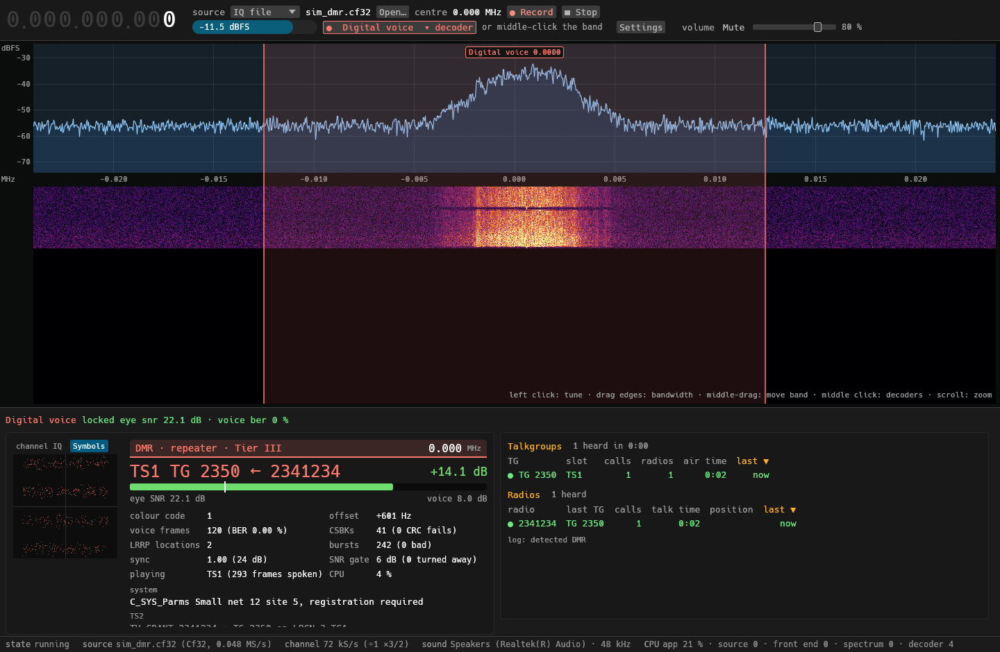
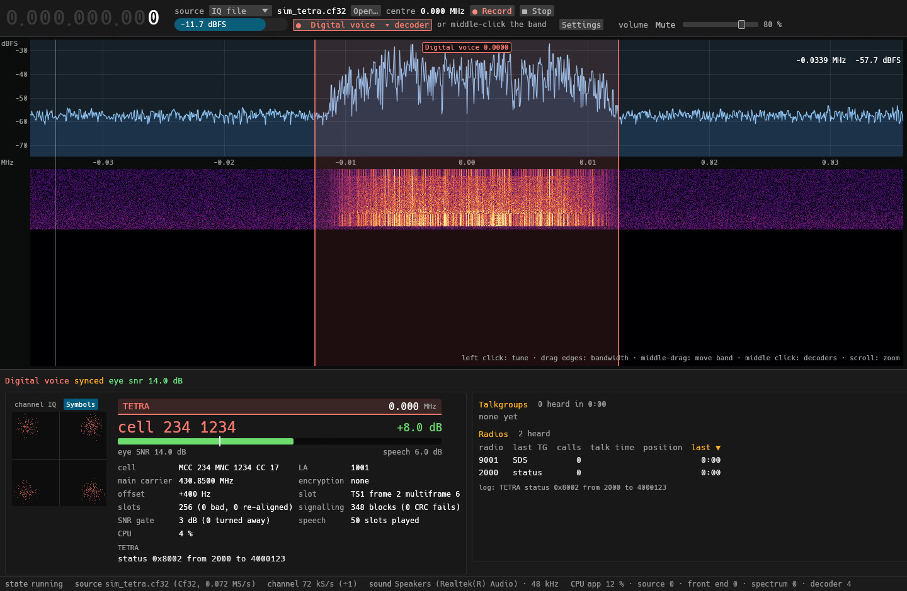
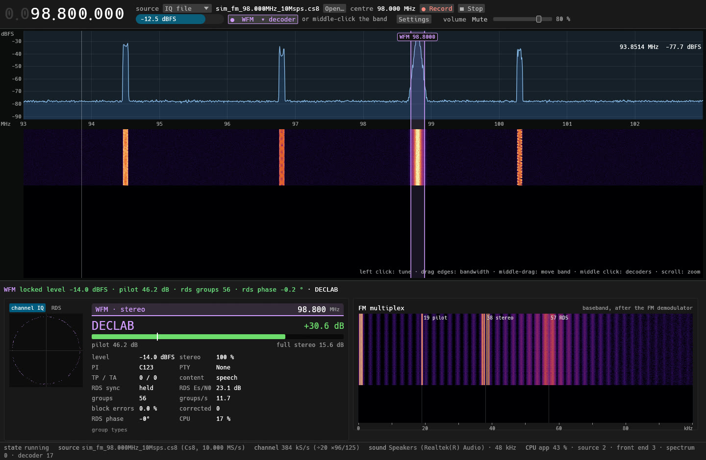
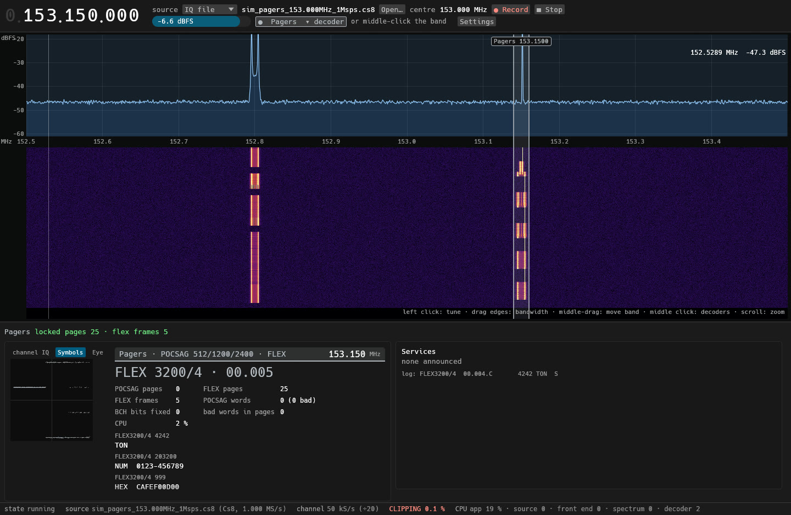
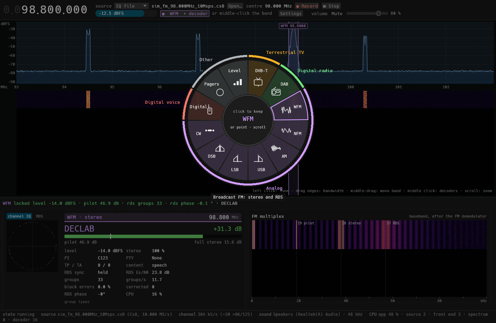

<!-- made by CasualArclamp -->
<p align="center">
  
</p>

# DecLAB

**One software-defined radio receiver for everything on the air.** Point an
RTL-SDR, Airspy or HackRF at the sky and DecLAB decodes terrestrial TV,
digital radio, FM, pagers and two-way digital voice, all in one window, all
in Rust, all from one portable `.exe`.

| | Modes |
|---|---|
| 📺 **Terrestrial TV** | DVB-T and DVB-T2 (found blind), with the programme guide, Red Button and transport-stream out |
| 📻 **Digital radio** | DAB and DAB+, with station text (DLS) and slideshows |
| 〰️ **Analog** | FM with RDS, NFM, AM, USB, LSB, DSB and CW |
| 📟 **Pagers** | POCSAG and FLEX |
| 🎙️ **Digital voice** | DMR (Tier I, II and III, LRRP positions), NXDN48, NXDN96, P25 phase 1 and TETRA, detected by itself |

**Several decoders at once.** Run up to eight VFOs on one radio, each with its
own decoder, sound and settings. The VFO list down the left collapses to a
strip of numbered discs; click a channel on the band to select it, ctrl+click
to add one. **Bias tee** for an LNA or active antenna on the Airspy R2,
HackRF One and RTL-SDR Blog: off at every start, switched on by you.

## Screenshots

**DVB-T/T2:** the multiplex, its services and the constellation.



**DAB+:** the ensemble's services, HE-AAC v2 sound and the station's text.



**Digital voice:** talkgroups and radios heard, sortable by any column, with
the system named in the card (MOTOTRBO, Capacity Plus, Hytera…).



**TETRA:** the cell, its neighbours (click a frequency to tune there) and the
four-point constellation once the receiver has locked.



**FM with RDS:** the station name, the multiplex with its pilot, stereo and
RDS subcarriers.



**Pagers:** POCSAG and FLEX messages as they arrive.



**The decoder wheel:** middle-click anywhere to pick a decoder.



## Built for weak signals

Every digital voice mode was tuned on simulated channels down to the noise
floor, and every one has an SNR gate so noise never turns into false calls:

- **DMR:** 96 % of voice frames at 5 dB C/N (discriminator, 800 Hz offset).
- **TETRA:** coherent detection with a log-MAP over the differential coding,
  about 2 dB better than differential detection; signalling 100 % down to
  6 dB C/N.
- **No false decodes:** two minutes of pure noise into each mode, with the
  gate on, produced nothing.
- **Real recordings:** the receivers re-align after a radio drops samples, so
  a lost USB transfer no longer costs the lock.

CPU is the main design requirement: a locked TETRA receiver takes under 1 %
of one core.

## Getting started

### Portable build (Windows x64)

```powershell
powershell -ExecutionPolicy Bypass -File scripts\build-portable.ps1
```

This writes `declab-gui.exe` and `declab.exe` to `exe\`: copy the folder
anywhere and run them, no installer and no runtime DLLs.

Radios need the WinUSB driver, installed once with
[Zadig](https://zadig.akeo.ie/). DecLAB talks to them through its own pure
Rust drivers.

### From source

```bash
git clone --recursive https://github.com/CasualArclamp/DecLAB.git
cd DecLAB
cargo run --release -p declab-gui
```

`--recursive` fetches libxaac (the DAB+ audio decoder), which builds the
first time in about a minute. You need stable Rust (1.95 or newer) and a C
compiler.

### Command line

```bash
declab list                                                    # the decoders
declab run dab --file 11d_222.064MHz_4.096Msps.cs8 --service "classic fm" --wav out.wav
declab run voice --radio rtlsdr --freq 439.5M --gain 40.2 --card
declab run wfm --radio airspy --freq 98M --offset 1.2M
```

IQ files are read as cs8, cu8, cs16 or cf32 (from the extension); the
centre frequency and rate are taken from names like
`x_98.000MHz_10Msps.cs8`.

## How it fits together

Each decoder is a plug-in: the host hands it IQ samples at the rate it asks
for, and it hands back sound, pictures, transport streams, text, a card and
scopes. A new decoder is one file. See [docs/DESIGN.md](docs/DESIGN.md) for
the architecture, the milestones and what was measured along the way.

## Notes

- **Encryption:** encrypted calls are shown as encrypted and are not decoded.
- **TETRA speech:** the ACELP codec is ETSI-licensed, so it is not in this
  repository. Without it TETRA decodes in full except that speech is not
  played.
- **Listen responsibly:** what you may receive, and what you may do with it,
  depends on where you are.

## Credits

DecLAB brings together the author's earlier receivers (DecDVB-T, DecSAT,
DecDAB and DecPagers). It also learns from and credits, at the code that
borrows from them: [mbelib](https://github.com/szechyjs/mbelib) (AMBE+2 and
IMBE), DSD, MMDVMHost, SDRTrunk, Dream and welle.io. DAB+ audio is decoded by
[libxaac](https://github.com/ittiam-systems/libxaac) (Apache-2.0).

## Licence

GPL-3.0-or-later. See [LICENSE](LICENSE).
