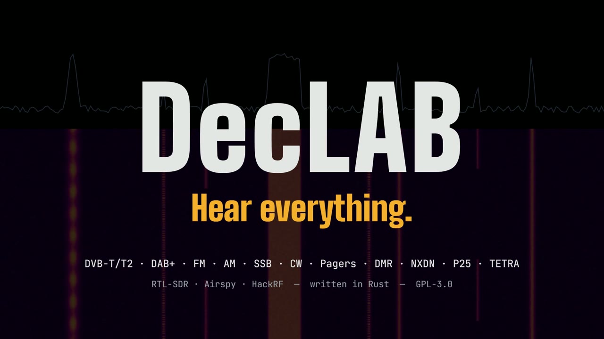
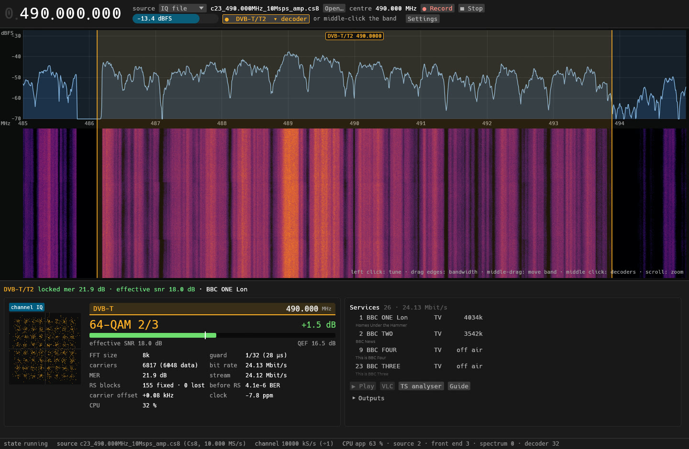
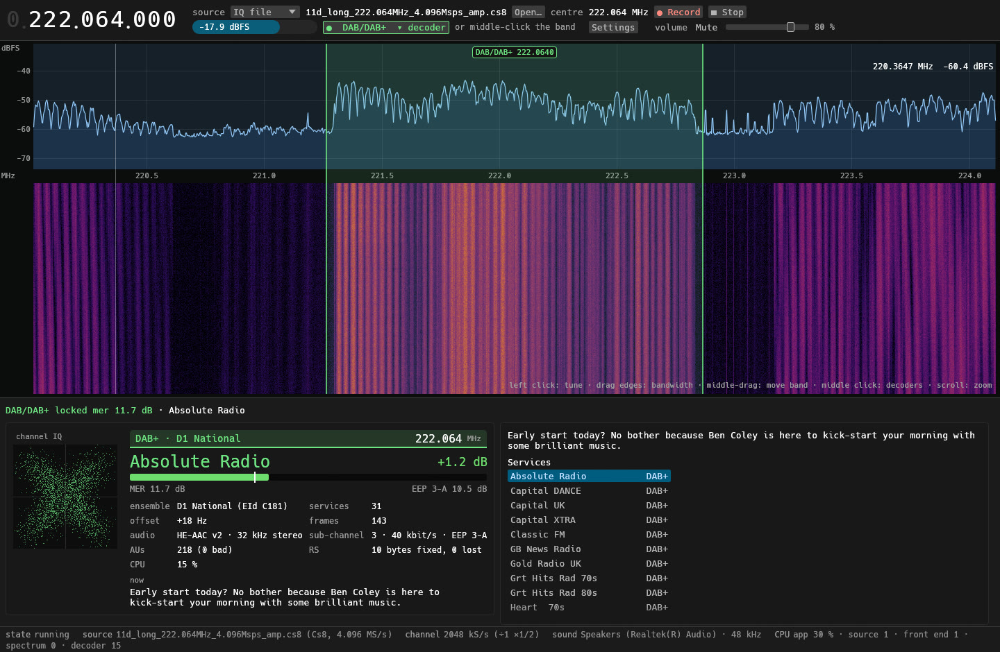
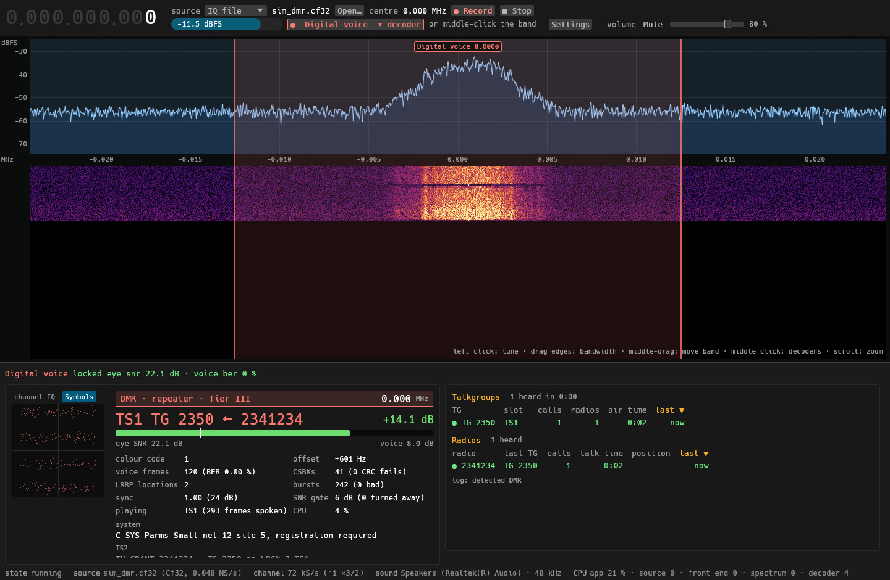
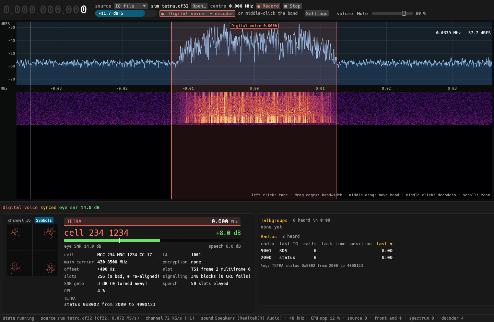
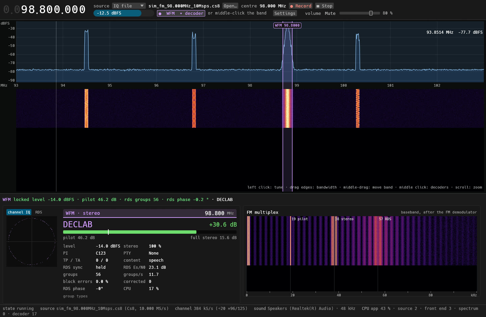
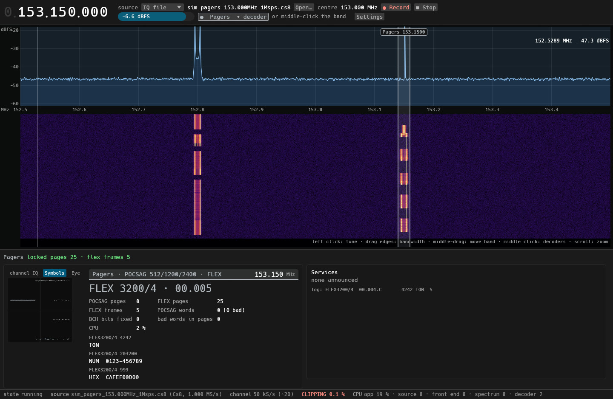
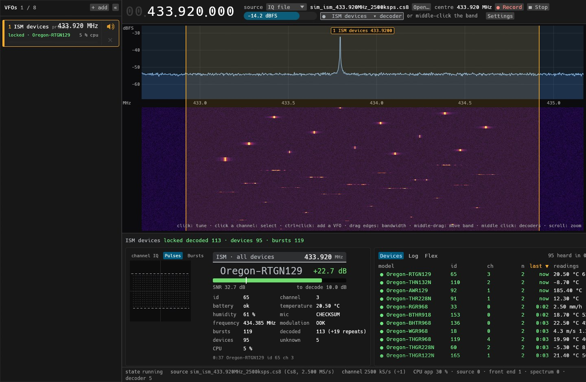
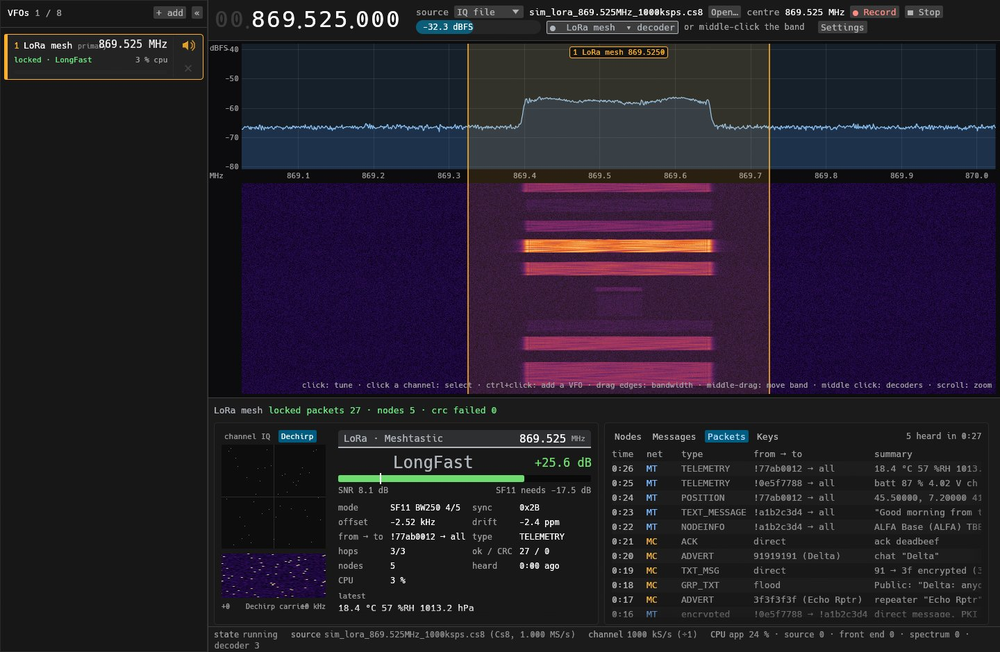
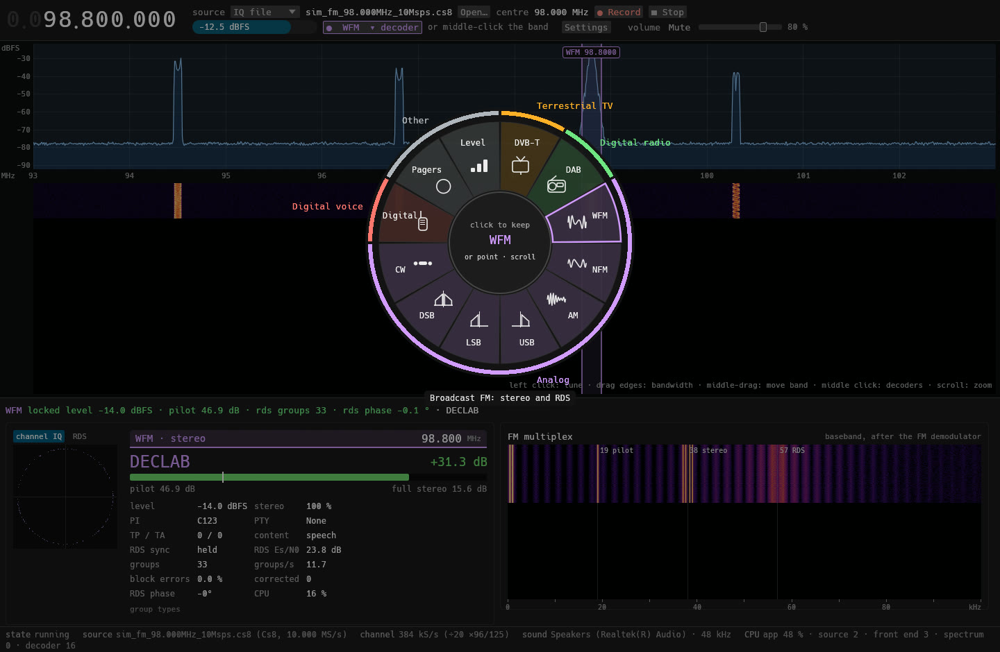

<!-- made by CasualArclamp -->
<p align="center">
  
</p>

# DecLAB

If you've found this worth your time, please consider [donating via PayPal](https://www.paypal.me/Arclamp).

**One software-defined radio receiver for everything on the air.** Point an
RTL-SDR, Airspy, HydraSDR, HackRF, ADALM-PLUTO, Fobos SDR, SDRplay RSP or USRP at the sky and DecLAB decodes terrestrial TV,
digital radio, FM, pagers, two-way digital voice, the ISM bands' sensors
and remotes, and LoRa meshes, all in one window, all
in Rust, all from one portable `.exe`.

| | Modes |
|---|---|
| 🛰️ **Satellite** | DVB-S, DVB-S2 and DVB-S2X (found blind, ACM): transport streams with the same services list, player and guide, and GSE as IP datagrams to a PCAP |
| 📺 **Terrestrial TV** | DVB-T and DVB-T2 (found blind), with the programme guide, Red Button and transport-stream out |
| 📻 **Digital radio** | DAB and DAB+, with station text (DLS) and slideshows |
| 〰️ **Analog** | FM with RDS, NFM, AM, USB, LSB, DSB and CW; squelch by level, SNR or noise |
| 📟 **Pagers** | POCSAG and FLEX |
| 🌡️ **ISM devices** | Weather stations and sensors, remotes and door/window sensors, tyre-pressure sensors, energy monitors and meters on 433, 868, 315, 345 and 915 MHz, as [rtl_433](https://github.com/merbanan/rtl_433) decodes them (Oregon Scientific, Acurite, LaCrosse, Fine Offset/Ecowitt, Bresser, Nexus and more), plus your own flex decoders; bursts found anywhere in a 2 MHz channel, several at once |
| 📡 **LoRa mesh** | Meshtastic and MeshCore: every LoRa preset (SF7–12, 62.5–500 kHz) found by itself; Meshtastic's default channels decrypted (text, positions, node info, telemetry), MeshCore's adverts and Public channel; nodes, messages and packets tables |
| 🎙️ **Digital voice** | DMR (Tier I, II and III, LRRP positions), NXDN48, NXDN96, P25 phase 1 and phase 2 (TDMA, scrambling found by itself; a control channel's grants open a VFO for each call) and TETRA, detected by itself; data as a hex dump, LRRP table and IP view |

**Several decoders at once.** Run up to eight VFOs on one radio, each with its
own decoder, sound and settings. The VFO list down the left collapses to a
strip of numbered discs; click a channel on the band to select it, ctrl+click
to add one. **Bias tee** for an LNA or active antenna on the Airspy R2
(and HydraSDR RFOne), HackRF One and RTL-SDR Blog: off at every start, switched on by you.

## Screenshots

**DVB-T/T2:** the multiplex, its services and the constellation.



**DAB+:** the ensemble's services, HE-AAC v2 sound and the station's text.



**Digital voice:** talkgroups and radios heard, sortable by any column, with
the system named in the card (MOTOTRBO, Capacity Plus, Hytera…).



**TETRA:** the cell, its neighbours (click a frequency to tune there) and the
four-point constellation once the receiver has locked.



**FM with RDS:** the station name, the multiplex with its pilot, stereo and
RDS subcarriers.



**Pagers:** POCSAG and FLEX messages as they arrive.



**ISM devices:** every sensor, remote and tyre heard, sortable, with its
latest readings; the band's bursts, the last one's pulses, and a log line a
message.



**LoRa mesh:** Meshtastic and MeshCore nodes, messages and every packet,
with the preset it was sent on, its SNR against what it needs, and the
symbols of the last frame.



**The decoder wheel:** middle-click anywhere to pick a decoder.



## Built for weak signals

Every digital voice mode was tuned on simulated channels down to the noise
floor, and every one has an SNR gate so noise never turns into false calls:

- **DMR:** 96 % of voice frames at 5 dB C/N (discriminator, 800 Hz offset).
- **TETRA:** coherent detection with a log-MAP over the differential coding,
  about 2 dB better than differential detection; signalling 100 % down to
  6 dB C/N.
- **No false decodes:** two minutes of pure noise into each mode, with the
  gate on, produced nothing.
- **Real recordings:** the receivers re-align after a radio drops samples, so
  a lost USB transfer no longer costs the lock.

CPU is the main design requirement: a locked TETRA receiver takes under 1 %
of one core.

## Getting started

### Portable build (Windows x64)

```powershell
powershell -ExecutionPolicy Bypass -File scripts\build-portable.ps1
```

This writes `declab-gui.exe` and `declab.exe` to `exe\`: copy the folder
anywhere and run them, no installer and no runtime DLLs.

Radios need the WinUSB driver, installed once with
[Zadig](https://zadig.akeo.ie/). DecLAB talks to them through its own pure
Rust drivers.

**ADALM-PLUTO and Pluto+ (receive only).** Over USB the Pluto needs ADI's
Pluto USB driver (WinUSB); or give its network address, `ip:192.168.2.1`.
A Pluto+ on Ethernet is `ip:ADDRESS`. Tezuka firmware streams 8-bit IQ,
which DecLAB uses by itself, so USB carries about 13 MS/s instead of 6.8.

**Fobos SDR, SDRplay RSP and USRP (receive only).** These three use their
maker's own library, loaded when you start the radio, so DecLAB still runs
without it. The Fobos needs RigExpert's `fobos_sdr.dll` (agile firmware) or
`fobos.dll` (stock) beside `declab-gui.exe`; an SDRplay needs the SDRplay API
installed from sdrplay.com; a USRP needs UHD installed (`uhd.dll` in
`C:\Program Files\UHD\bin`, or its path in the `UHD_DLL` variable; Windows
only). None of the three has been tried on the real radio from DecLAB yet.

**A radio on another machine.** "DecSAT server" takes a radio from
[DecSAT](https://github.com/CasualArclamp/DecSAT)'s `decsat-server` running
elsewhere: give its address, and the server's name for the radio (`hackrf`,
`pluto`, …; empty for its first). The IQ comes over one TCP connection,
packed to 4 to 16 bits a sample, and is decoded here. The link is not
encrypted: over the internet, use a VPN or an SSH tunnel.

**Any other radio, over the network.** "Network IQ" takes raw IQ from
another program: SDR++'s IQ Exporter (so an SDRplay RSPduo or anything else
SDR++ drives), GNU Radio's TCP or UDP sinks, or an rtl_tcp server (which
DecLAB also tunes). Connect to a TCP server (`tcp://127.0.0.1:7777`), wait
for a sender (`listen://0.0.0.0:7777`) or take UDP (`udp://0.0.0.0:7777`),
in int8, uint8, int16, int32 or float32. The stream does not carry its
rate or frequency, so you enter them.

### From source

```bash
git clone --recursive https://github.com/CasualArclamp/DecLAB.git
cd DecLAB
cargo run --release -p declab-gui
```

`--recursive` fetches libxaac (the DAB+ audio decoder), which builds the
first time in about a minute. You need stable Rust (1.95 or newer) and a C
compiler.

### Command line

```bash
declab list                                                    # the decoders
declab run dab --file 11d_222.064MHz_4.096Msps.cs8 --service "classic fm" --wav out.wav
declab run voice --radio rtlsdr --freq 439.5M --gain 40.2 --card
declab run wfm --radio airspy --freq 98M --offset 1.2M
declab run wfm --radio pluto --freq 98M --pluto-uri ip:192.168.2.1 --gain agc
declab run wfm --radio sdrplay --freq 98M --rate 2M --gain 4,40
declab run wfm --radio remote --remote 192.168.1.20 --remote-radio hackrf --freq 98M --rate 8M --offset 0.8M
declab run wfm --net tcp://127.0.0.1:7777 --iq int8 --rate 10M --freq 98M --offset 0.8M
```

IQ files are read as cs8, cu8, cs16 or cf32 (from the extension); the
centre frequency and rate are taken from names like
`x_98.000MHz_10Msps.cs8`.

## How it fits together

Each decoder is a plug-in: the host hands it IQ samples at the rate it asks
for, and it hands back sound, pictures, transport streams, text, a card and
scopes. A new decoder is one file. See [docs/DESIGN.md](docs/DESIGN.md) for
the architecture, the milestones and what was measured along the way.

## Notes

- **Encryption:** encrypted calls are shown as encrypted and are not decoded.
- **TETRA speech:** the ACELP codec is ETSI-licensed, so it is not in this
  repository. Without it TETRA decodes in full except that speech is not
  played.
- **Listen responsibly:** what you may receive, and what you may do with it,
  depends on where you are.

## Credits

DecLAB brings together the author's earlier receivers (DecDVB-T, DecSAT,
DecDAB and DecPagers). It also learns from and credits, at the code that
borrows from them: [mbelib](https://github.com/szechyjs/mbelib) (AMBE+2 and
IMBE), DSD, MMDVMHost, SDRTrunk, Dream and welle.io. The ISM device
decoders, pulse slicers and flex decoder are ported from
[rtl_433](https://github.com/merbanan/rtl_433) (GPL-2.0-or-later), credited
in each file. The LoRa coding chain is ported from
[gr-lora_sdr](https://github.com/tapparelj/gr-lora_sdr) (GPL-3.0-or-later);
the Meshtastic field numbers come from
[meshtastic/protobufs](https://github.com/meshtastic/protobufs) (GPL-3.0)
and MeshCore's layouts from [MeshCore](https://github.com/meshcore-dev/MeshCore)
(MIT). DAB+ audio is decoded by
[libxaac](https://github.com/ittiam-systems/libxaac) (Apache-2.0).

## Licence

GPL-3.0-or-later. See [LICENSE](LICENSE).
